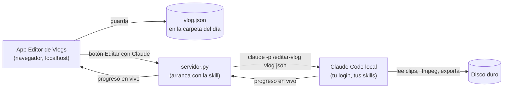

# Editor de Vlogs — estructura de la app

Mapa de la app: qué secciones tiene, en qué orden se usan, qué decide Snati en cada una,
qué hace Claude y qué sale de cada paso. Cada sección nueva se construye siguiendo este mapa.

## Cómo se conecta todo (decidido)

Claude corre **en la Mac de Snati** (Claude Code local), nunca en la nube. La app también corre en la Mac.

- **Botón "Editar con Claude":** el servidor local lanza Claude Code como comando
  (`claude -p "/editar-vlog <ruta>/vlog.json"`) parado en la carpeta del repo. Carga CLAUDE.md y las skills,
  usa el login de Snati, y el avance se ve en vivo en la app (`--output-format stream-json --verbose`).
  Con `--resume <id>` cada botón sigue la misma conversación.
- **Permisos:** se fijan en el comando (ej. `--permission-mode acceptEdits --allowedTools "Bash(ffmpeg *)"`),
  porque en modo comando lo que necesita aprobación se rechaza solo. No usar `--bare` (desactiva skills y login).
- **Chat dentro de la app:** posible con el Claude Agent SDK, pero la documentación pide API key
  (no la suscripción). Queda para más adelante.
- **iOS:** Claude Code no corre en el iPhone. El iPhone solo puede manejar la sesión de la Mac (Remote Control).
- **Sala de Color publicada en claude.ai:** queda como prueba visual. La que se usa para editar es la versión local.
- No hay forma documentada de meter mensajes en una sesión interactiva ya abierta: el camino es lanzar `claude -p`.

Fuentes: code.claude.com/docs/en/headless.md · cli-reference.md · agent-sdk/overview.md · remote-control.md

---

## Secciones

El orden es el del trabajo real. Cada sección tiene un estado: `pendiente` / `en curso` / `aprobado`.

### 0. Vlog (proyecto)
- **Snati:** título (da la dirección del video), carpeta del día, fecha.
- **Claude:** crea el proyecto en la base y la carpeta de trabajo `_edicion/` dentro de la carpeta del día.
- **Sale:** documento `vlogs/<id>` con título, carpeta y estado de cada sección.

### 1. Material
- **Claude:** escanea la carpeta en el orden en que está. Por cada clip: duración, resolución, fps,
  perfil (D-Log / D-Log 2 / Rec709, detectado por metadatos), si tiene audio. Los clips de `broll/` quedan marcados como b-roll.
- **Snati:** revisa la lista, descarta clips, corrige perfil si hace falta.
- **Sale:** lista de clips con miniatura y datos.

### 2. Color — HECHO (Sala de Color v2)
- **Snati:** LUT e intensidad por perfil, con antes/después. Barras (formato y dónde van).
- **Claude:** aplica la LUT y el % de cada perfil a cada clip.
- **Sale:** `looks/<perfil>` y `ajustes/barras`.
- Falta: usar capturas del propio material de la sección 1 en vez de subirlas a mano.

### 3. Historia
- **Claude:** transcribe todo (Whisper), arma la estructura según el título:
  teaser de apertura (15–30 s), bloques de charla, montajes entre bloques y cierre.
- **Snati:** aprueba o mueve bloques, elige el momento del teaser.
- **Sale:** guion de edición (lista de bloques con clip, entrada y salida).

### 4. Cortes
- **Claude:** saca silencios > 0,25 s, muletillas y correcciones. Alterna encuadre (punch-in) en jump cuts.
- **Snati:** escucha los cortes dudosos y decide si quedan.
- **Sale:** lista de cortes por clip.

### 4b. Audio
- **Snati:** qué fuente de voz usar si hay dos (mic o cámara).
- **Claude:** limpia ruido y viento, empareja el volumen de la voz entre clips, deja el ambiente bajo en los montajes.
- **Sale:** ajustes de voz por clip.

### 5. Música
- **Snati:** temas (instrumentales bajadas) y en qué montajes van.
- **Claude:** detecta tempo y beats, corta los montajes en el beat (1/2/4/8 beats por plano),
  música fuerte en montajes, sin música en la charla, fade de 3–5 s al volver a hablar.
- **Sale:** mapa de música (tema, entrada, salida, volumen, fades).

### 6. Textos
- **Snati:** si van subtítulos, título de episodio, lugar/hora en separadores.
- **Claude:** genera subtítulos chicos y blancos, títulos en rojo neon condensado, lugar + hora.
- **Sale:** lista de textos con tiempo y estilo.

### 6b. Línea de tiempo
- **Snati:** retoca lo que armó Claude, como en Premiere: monitor de programa, inspector y pistas
  Textos, Color (capas con LUT), Video, Voz, Música y Efectos de sonido. Selección, cuchilla,
  mover, recortar, reordenar, imán, zoom, deshacer.
- **Claude:** respeta esa edición (no la regenera); aplica notas encima.
- **Sale:** `_edicion/plan.json` con `editado_a_mano` (la versión de Claude queda en `planes/plan_claude_*.json`).
  Formato: `references/plan_json.md`. Se puede exportar directo desde ahí.

### 7. Exportar
- **Claude:** arma el video completo: 16:9, barras, color, cortes, música, textos, audio a –14 LUFS.
  Primero una versión liviana para revisar y después la final.
- **Sale:** `Vlog_<titulo>_v1.mp4` (versionado: v2, v3…) en `_edicion/`.

### 7b. Abrir en Premiere
- Botón en Exportar y en la Línea de tiempo: arma `_edicion/premiere/` con el XML de la secuencia,
  subtítulos `.srt` y textos/barras en PNG. En la Mac lo abre con Premiere y muestra la carpeta en Finder.
- La LUT va en el nombre de cada clip y en marcadores (se aplica en Lumetri).

### 8. Revisión
- **Snati:** mira la versión y deja notas con minuto ("2:14 cortar antes").
- **Claude:** aplica las notas y saca la siguiente versión.
- **Sale:** historial de versiones y notas.

---

## Quién necesita qué

| Uso | Qué necesita la persona | Quién paga a Claude |
|---|---|---|
| **Snati (uso propio)** — modo actual | Mac + Claude Code instalado y logueado con su plan (Pro/Max) + ffmpeg/Python (los instala la skill) | Su suscripción |
| **Otros usuarios con Claude Code** | Lo mismo: cada uno con su Claude Code y su plan; se le pasa el repo/skill + la app | La suscripción de cada uno |
| **Otros usuarios SIN Claude Code** (producto) | Solo la app. Claude va adentro con el Claude Agent SDK | Una API key (de Snati o del usuario), se paga por uso. No se puede usar el login de claude.ai de otros |

## Datos en la base (por vlog)

| Documento | Qué guarda |
|---|---|
| `vlogs/<id>` | título, carpeta, fecha, estado de cada sección |
| `vlogs/<id>/clips/<n>` | archivo, orden, duración, perfil, b-roll sí/no, descartado sí/no |
| `looks/<perfil>` | LUT, archivo, intensidad (global, se reusa entre vlogs) |
| `ajustes/barras` | formato y dónde van (global) |
| `vlogs/<id>/historia` | bloques del guion de edición |
| `vlogs/<id>/musica` | mapa de música |
| `vlogs/<id>/textos` | textos en pantalla |
| `vlogs/<id>/versiones/<n>` | archivo exportado, fecha, notas de revisión |

## Orden de construcción

1. ~~Color~~ (hecho)
2. **Lanzador local**: `servidor.py` + botón "Editar con Claude" que corre `claude -p` y muestra el progreso.
3. Vlog + Material (lo mínimo para arrancar un video real)
4. Historia + Cortes
5. Música
6. Textos
7. Exportar + Revisión
8. Más adelante: app nativa Mac / iOS con estas mismas secciones.
