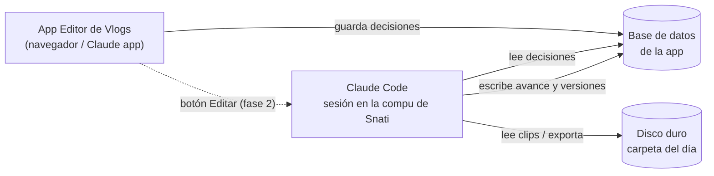

# Editor de Vlogs — estructura de la app

Mapa de la app: qué secciones tiene, en qué orden se usan, qué decide Snati en cada una,
qué hace Claude y qué sale de cada paso. Cada sección nueva se construye siguiendo este mapa.

## Cómo se conecta todo

- **La app** es la interfaz: Snati elige y aprueba.
- **La base de datos** es el lugar donde quedan las decisiones del vlog. Claude la lee y escribe.
- **Claude Code en la compu de Snati** es el que edita: ve el disco, corre ffmpeg y Whisper, y exporta.
- **El botón Editar** (fase 2) le avisa a la sesión de Claude Code que arranque, sin escribir en el chat.

### Qué está confirmado y qué no

| Conexión | Estado |
|---|---|
| App → base de datos → Claude lee | **Probado.** Claude lee la base con la herramienta ArtifactData. |
| Claude escribe en la base y la app lo muestra en vivo | Soportado por la plataforma, se prueba al armar la sección Revisión. |
| Botón en la app que le manda un mensaje a la sesión de Claude Code | Posible (conector "Claude Code Remote" desde la app). **Sin probar.** |
| Claude Code en la nube viendo el disco | **No se puede.** Para editar hace falta la sesión en la compu de Snati. |

---

## Secciones

El orden es el del trabajo real. Cada sección tiene un estado: `pendiente` / `en curso` / `aprobado`.

### 0. Vlog (proyecto)
- **Snati:** título (da la dirección del video), carpeta del día, fecha.
- **Claude:** crea el proyecto en la base y la carpeta de trabajo `_edicion/` dentro de la carpeta del día.
- **Sale:** documento `vlogs/<id>` con título, carpeta y estado de cada sección.

### 1. Material
- **Claude:** escanea la carpeta en el orden en que está. Por cada clip: duración, resolución, fps,
  perfil (D-Log / D-Log 2 / Rec709, detectado por metadatos), si tiene audio. Los clips de `broll/` quedan marcados como b-roll.
- **Snati:** revisa la lista, descarta clips, corrige perfil si hace falta.
- **Sale:** lista de clips con miniatura y datos.

### 2. Color — HECHO (Sala de Color v2)
- **Snati:** LUT e intensidad por perfil, con antes/después. Barras (formato y dónde van).
- **Claude:** aplica la LUT y el % de cada perfil a cada clip.
- **Sale:** `looks/<perfil>` y `ajustes/barras`.
- Falta: usar capturas del propio material de la sección 1 en vez de subirlas a mano.

### 3. Historia
- **Claude:** transcribe todo (Whisper), arma la estructura según el título:
  teaser de apertura (15–30 s), bloques de charla, montajes entre bloques y cierre.
- **Snati:** aprueba o mueve bloques, elige el momento del teaser.
- **Sale:** guion de edición (lista de bloques con clip, entrada y salida).

### 4. Cortes
- **Claude:** saca silencios > 0,25 s, muletillas y correcciones. Alterna encuadre (punch-in) en jump cuts.
- **Snati:** escucha los cortes dudosos y decide si quedan.
- **Sale:** lista de cortes por clip.

### 5. Música
- **Snati:** temas (instrumentales bajadas) y en qué montajes van.
- **Claude:** detecta tempo y beats, corta los montajes en el beat (1/2/4/8 beats por plano),
  música fuerte en montajes, sin música en la charla, fade de 3–5 s al volver a hablar.
- **Sale:** mapa de música (tema, entrada, salida, volumen, fades).

### 6. Textos
- **Snati:** si van subtítulos, título de episodio, lugar/hora en separadores.
- **Claude:** genera subtítulos chicos y blancos, títulos en rojo neon condensado, lugar + hora.
- **Sale:** lista de textos con tiempo y estilo.

### 7. Exportar
- **Claude:** arma el video completo: 16:9, barras, color, cortes, música, textos, audio a –14 LUFS.
  Primero una versión liviana para revisar y después la final.
- **Sale:** `Vlog_<titulo>_v1.mp4` (versionado: v2, v3…) en `_edicion/`.

### 8. Revisión
- **Snati:** mira la versión y deja notas con minuto ("2:14 cortar antes").
- **Claude:** aplica las notas y saca la siguiente versión.
- **Sale:** historial de versiones y notas.

---

## Datos en la base (por vlog)

| Documento | Qué guarda |
|---|---|
| `vlogs/<id>` | título, carpeta, fecha, estado de cada sección |
| `vlogs/<id>/clips/<n>` | archivo, orden, duración, perfil, b-roll sí/no, descartado sí/no |
| `looks/<perfil>` | LUT, archivo, intensidad (global, se reusa entre vlogs) |
| `ajustes/barras` | formato y dónde van (global) |
| `vlogs/<id>/historia` | bloques del guion de edición |
| `vlogs/<id>/musica` | mapa de música |
| `vlogs/<id>/textos` | textos en pantalla |
| `vlogs/<id>/versiones/<n>` | archivo exportado, fecha, notas de revisión |

## Orden de construcción

1. ~~Color~~ (hecho)
2. **Prueba de conexión**: botón en la app que avisa a la sesión de Claude Code.
3. Vlog + Material (lo mínimo para arrancar un video real)
4. Historia + Cortes
5. Música
6. Textos
7. Exportar + Revisión
8. Más adelante: app nativa Mac / iOS con estas mismas secciones.
