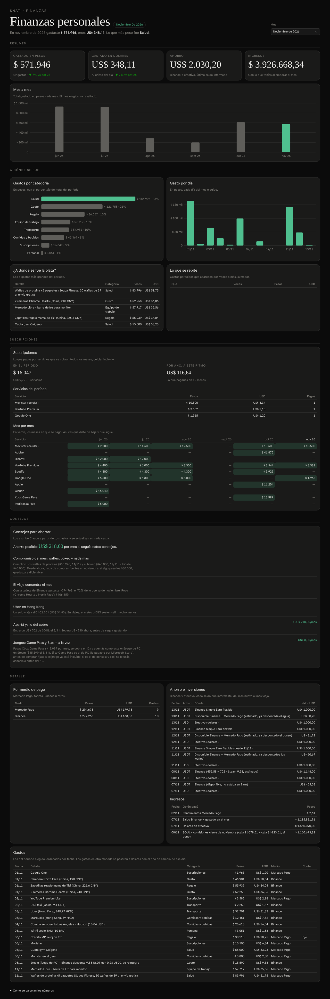
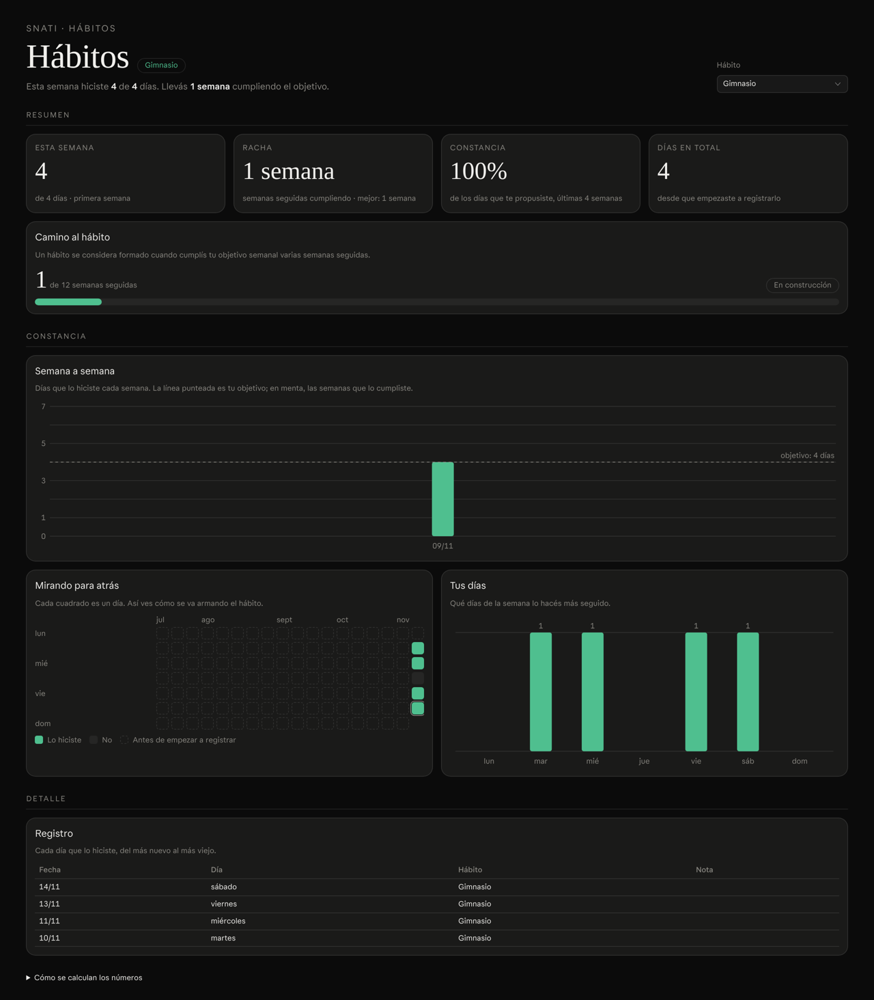

# Estética de los dashboards de Snati

Esta es la estética de los dashboards de **Finanzas** y **Hábitos**. Cualquier dashboard nuevo tiene que
verse **idéntico**: mismos colores, tipografías, tamaños, espacios, componentes y gráficos.
Snati la eligió así: **gris oscuro, sobrio, un solo acento verde menta**.

## 1. Base técnica

- Se arma sobre el tipo de artifact **Data** de Claude (`https://claude.ai/artifact/GZLZthZ2sQjn7T16skfdeF`).
  El fondo, las superficies y las tipografías salen de los **tokens del tipo** (`--color-*`, `--cds-*`,
  `--font-anthropic-*`). **Nunca se escriben colores fijos para fondo, tarjetas o texto**: así sigue el gris
  del modo oscuro de Claude (Snati probó un grafito fijo y prefirió volver a este gris).
- La página abre con `<meta name="dash-one-writer">`: los textos fijos van en el HTML y los números se dibujan
  con `dash.draw` en elementos marcados (`data-draw`, `data-source`, `data-field`, `data-where`).
- Todo el CSS usa clases con prefijo **`fz-`** (nada de estilos sobre `body`, `html` o etiquetas sueltas).
- Copia exacta del CSS: el bloque `<style>` de `Finanzas/Dashboard/index.html` (es el mismo en
  `Habitos/Dashboard/index.html`). Para un dashboard nuevo, se copia ese bloque tal cual y se agregan al final
  solo las clases propias que hagan falta.

## 2. Color

| Uso | Token | Valor aproximado en modo oscuro |
|---|---|---|
| Fondo de la página | `--color-bg` | gris casi negro (~#0b0b0b – #191919) |
| Tarjetas | `--color-panel` | gris oscuro (~#1a1a19 – #1f1f1f) |
| Bordes y separadores | `--color-border-line` | blanco al 4–10% |
| Texto principal | `--color-fg` | ~#f0efec |
| Texto secundario | `--color-fg-muted` | ~#898781 |
| Etiquetas chicas (eyebrows, rótulos de tarjeta) | `--fz-faint` (= `--color-fg-muted`) | |
| Relieve suave (hover de filas, fondo de barras de progreso, selector) | `--fz-raise` = `color-mix(in srgb, var(--color-fg) 6%, transparent)` | |
| **Acento** (barras destacadas, etiqueta del mes, ahorro, progreso) | `--fz-accent` = **`#4fbf8f`** (verde menta) | el único color propio |
| Bien / mejor | `--color-ok` (verde) | ~#53c556 |
| Mal / peor | `--color-bad` (rojo) | ~#f17778 |
| Barras no destacadas | `--cds-chart-muted` | gris medio |
| Grilla de gráficos | `--cds-chart-grid` | gris muy tenue |

Reglas:
- **Un solo acento.** En cada gráfico, solo lo importante va en menta (el mes elegido, la categoría más grande,
  la semana cumplida). Todo lo demás en `--cds-chart-muted`.
- Verde y rojo solo para comparar (▲ / ▼ contra el período anterior). **Gastar más es rojo, gastar menos es verde.**
  En hábitos es al revés: hacer más es verde.
- Los colores de los gráficos se ponen con `.style('fill', 'var(--…)')`, no con `.attr('fill', …)`.

## 3. Tipografía

| Elemento | Fuente | Tamaño | Detalle |
|---|---|---|---|
| Título de la página (h1) | `--font-anthropic-serif`, peso 400 | `clamp(2rem, 5vw, 3.1rem)` | interlineado 1.05 |
| Números grandes de las tarjetas | `--font-anthropic-serif`, peso 400 | `clamp(1.6rem, 3.4vw, 2.25rem)` | `tabular-nums` |
| Títulos de tarjeta (h2) | `--font-anthropic-sans` | `--cds-font-size-heading` | peso `--cds-font-weight-medium` (500) |
| Texto corriente | `--font-anthropic-sans` | `--cds-font-size-body` | |
| Notas debajo de los títulos, ejes, tablas | `--font-anthropic-sans` | `--cds-font-size-caption` | color `--color-fg-muted` |
| Eyebrows (SNATI · FINANZAS, RESUMEN, …) | sans | caption | MAYÚSCULAS, `letter-spacing: .14em`, color `--fz-faint` |
| Rótulos de tarjetas chicas (GASTADO EN PESOS) | sans | caption | MAYÚSCULAS, `letter-spacing: .08em` |

Todos los números en columnas o que cambian llevan `font-variant-numeric: tabular-nums`.
Formato argentino: `Intl.NumberFormat('es-AR')`: `$ 571.946`, `US$ 348,11`, porcentajes sin decimales.

## 4. Estructura de la página (de arriba hacia abajo)

1. **Encabezado** (`.fz-head`): eyebrow `SNATI · <TEMA>`, título serif grande y al lado una **etiqueta tipo
   píldora** (`.fz-pill`, borde fino redondeado, texto en menta) con lo que se está mirando (mes o hábito).
   Debajo, **una frase** con los números clave en negrita. A la derecha, el **selector** (`.dash-select`
   dentro de `.fz-pick`, con rótulo arriba).
2. **Secciones** (`.fz-sec`), cada una con un **eyebrow** en mayúsculas y una línea fina debajo
   (RESUMEN, A DÓNDE SE FUE, SUSCRIPCIONES, CONSEJOS, DETALLE / RESUMEN, CONSTANCIA, DETALLE).
3. **Fila de 4 tarjetas** (`.fz-tiles`): rótulo en mayúsculas, número serif grande, línea chica debajo con
   contexto y la **comparación** (`.fz-delta`: `▲ 7% vs oct 26`, verde/rojo).
4. **Tarjetas de contenido** (`.fz-card`): fondo `--color-panel`, borde 1px `--color-border-line`,
   **radio 14px**, padding `--cds-pad-lg`. Título (h2) + nota corta (`.fz-note`) + gráfico o tabla.
   Van solas a todo el ancho o de a dos en una grilla (`.fz-grid`, columnas de mínimo 22rem).
5. **Al final**, un `
` cerrado: "Cómo se calculan los números", con términos y definiciones.

Espacios: entre secciones `calc(var(--cds-gap-lg) * 1.25)`; entre tarjetas `--cds-gap-md`; dentro de una
tarjeta `--cds-gap-sm`. Nada de anchos fijos: todo se acomoda a ~400px (celular), donde las tarjetas pasan a
una columna y las columnas secundarias de las tablas se esconden (`.fz-hide-narrow`).

## 5. Gráficos (d3)

- **Barras verticales** (por mes, por día, por semana): ancho máximo 32px, esquinas `rx=3`, grilla horizontal
  tenue, etiquetas de eje en caption y color muted, eje Y con valores cortos (`$ 200 mil`).
- **Barras horizontales** (categorías): nombre a la izquierda alineado a la derecha, barra, y al final
  `$ 186.996 · 33%` en muted. La primera (la más grande) en menta.
- **Línea de objetivo**: punteada (`stroke-dasharray 4 4`) en muted, con el texto `objetivo: 4 días` al final.
- **Tooltip** (`.fz-tip`): cajita flotante con fondo `--cds-surface-popover`, borde, sombra, radio; primera
  línea en gris (qué es), segunda con el valor. Va dentro del gráfico.
  En las barras por categoría, el tooltip suma una lista (`.fz-tip-list`) con los 10 gastos más grandes de esa
  categoría (fecha · detalle cortado con … · monto) y "y N más" si hay más. Aparece solo al pasar el cursor.
- **Grilla mes por mes / calendario**: un bloque por mes con su nombre y total arriba, separados por un espacio; celdas redondeadas que se achican para entrar en el ancho; las "activas" en menta (suave o lleno), las vacías
  en `--fz-raise`, las de antes de empezar con borde punteado.
- **Barra de progreso** (`.fz-progress`): 10px de alto, redonda, fondo `--fz-raise`, relleno menta.
- Los SVG van con `width="100%"` y `viewBox`, y se dibujan según `clientWidth`.

## 6. Tablas y listas

- `.fz-table`: texto caption, encabezados en muted con peso medio y línea inferior, filas separadas por línea
  fina, **hover con `--fz-raise`**, montos alineados a la derecha, encabezado pegajoso al hacer scroll
  (máx. 28rem de alto).
- **Consejos** (`.fz-tips`): lista sin viñetas; cada ítem con título en peso medio, a la derecha el ahorro
  posible en menta (`+US$ 13/mes`) y debajo el detalle en muted.
- **Etiqueta de estado** (`.fz-state`): píldora con borde; en menta cuando algo está logrado.

## 7. Textos

- Español rioplatense, cortos y concretos. Notas de una línea que dicen qué muestra el gráfico.
- Títulos de tarjeta con nombres que Snati reconoce: "Mes a mes", "A dónde se fue la plata", "Lo que se repite",
  "Camino al hábito", "Mirando para atrás", "Tus días".

## 8. Capturas

| Dashboard | Escritorio | Celular |
|---|---|---|
| Finanzas | [finanzas_escritorio.png](capturas/finanzas_escritorio.png) | [finanzas_celular.png](capturas/finanzas_celular.png) |
| Hábitos | [habitos_escritorio.png](capturas/habitos_escritorio.png) | [habitos_celular.png](capturas/habitos_celular.png) |

Las capturas se sacan con el visor local de `Diseno/visor/` (ver su `LEEME.txt`): reproduce la página con los
estilos reales del tipo Data y los CSV, y saca la foto con Playwright en modo oscuro.
